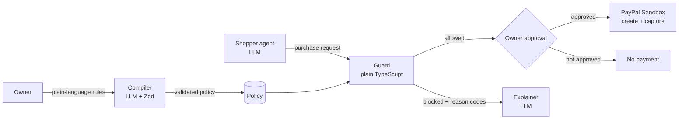

# Purchase Pal

**The AI asks. Your rules decide.**

Purchase Pal is an AI shopping assistant for Gen Z and freelancers. Tired of overspending or getting lost in endless online shopping? Let the agent find and explain products for you, while your own spending policy stays in charge of every payment.

It combines AI with straightforward code. The AI helps you interpret and explain product options so you can make informed decisions before the "buy" button. Deterministic server code enforces your spending policy, so your budget is respected. Purchase Pal never has the authority to approve a payment without your consent.

Built for the **PayPal AI Hackathon**. Sandbox only: no real money moves. The engineering codename is **AgentGuard**.

## How it works



| Part | What it does | Uses an LLM? |
|---|---|---|
| **Compiler** | Turns your plain-language rules into a strict policy. Asks a question when something is unclear instead of guessing. | Yes (Groq), output validated with Zod |
| **Shopper agent** | Searches products and asks to buy them. It can only request a payment. | Yes (Groq) |
| **Guard** | Checks every request against your policy and returns allow or block with reason codes. | **No**, plain TypeScript |
| **Explainer** | Explains a decision in plain words. It never makes the decision. | Yes (Groq) |
| **PayPal client** | Creates, approves and captures orders in the PayPal Sandbox. | No |

## Safety rules

- The LLM never decides whether a payment is allowed. The Guard does.
- The server takes product, merchant, price and currency from **our own catalog**, never from model output.
- All external and model data is validated with Zod. Invalid data is blocked (fail closed).
- Money is always **integer minor units** (`500` means 5.00 USD).
- Payments and approvals are designed to be idempotent.
- Sandbox only: the PayPal client refuses to run against a non-sandbox host.
- Product text is treated as data, not instructions (prompt-injection defence).

## Features

- **Policy manager:** maximum per transaction, manual approval threshold, daily and monthly limits, allowed merchants, blocked categories (for example gift cards or crypto) and allowed hours.
- **Live audit feed:** every purchase attempt is logged with the decision and the reason.
- **Approvals queue:** small purchases under your threshold are approved automatically. Anything above it waits for you, with a Telegram alert.
- **Disputes and escrow:** raise a dispute, track escrow resolution and read the AI Judge's verdict in plain language.
- **Ask Purchase Pal AI:** ask why a decision was made. The assistant explains decisions and can never approve one.

## Guard reason codes

| Code | Meaning |
|---|---|
| `INVALID_INPUT` | The request or spent-today value is malformed (for example a negative, decimal or text amount). |
| `INVALID_POLICY` | The policy itself is invalid. |
| `CURRENCY_MISMATCH` | The request currency is different from the policy currency. |
| `OVER_PER_TXN_LIMIT` | The amount is above the per-purchase limit. |
| `OVER_DAILY_LIMIT` | Today's total would go above the daily limit. |
| `MERCHANT_NOT_ALLOWED` | The merchant is not on the allowed list. |
| `CATEGORY_BLOCKED` | The product category is blocked. |
| `POLICY_EXPIRED` | The policy has expired. |

The Guard reports **every** rule that fails, not only the first.

## Tech stack

Next.js (App Router) and TypeScript, Zod, better-sqlite3, Vitest, Groq for the LLM calls, and the PayPal Orders API (Sandbox).

## Getting started

### Prerequisites

- Node.js 20.9 or newer
- A PayPal developer account with **Sandbox** accounts in the **United States**: one Business (merchant) and one Personal (buyer). Accounts from another country can fail with "This seller doesn't accept payments in your currency".
- A Groq API key

### Install

```bash
git clone <your-repo-url>
cd purchasepal
npm install
```

If npm blocks the native SQLite package, approve it and rebuild:

```bash
npm install-scripts approve better-sqlite3
npm rebuild better-sqlite3
```

### Configure

Create `.env.local` in the project root. Never commit this file.

```
PAYPAL_CLIENT_ID=your_sandbox_client_id
PAYPAL_CLIENT_SECRET=your_sandbox_secret
PAYPAL_BASE_URL=https://api-m.sandbox.paypal.com
GROQ_API_KEY=your_groq_key
MODEL_COMPILER=your_model_name
MODEL_SHOPPER=your_model_name
MODEL_EXPLAINER=your_model_name
```

Get the PayPal values from the PayPal developer dashboard: **Apps & Credentials**, Sandbox toggle on, create an app under your US Business sandbox account.

### Run

```bash
npm run dev
```

Open http://localhost:3000.

## Tests and evals

```bash
npm test                 # unit tests for the Guard
npm run eval:guard       # 40 guard cases, results saved to evals/results/
```

## PayPal Sandbox spike

A standalone script proves the full payment path without any UI: it creates a fixed 5.00 USD order, prints the buyer approval link, waits for you to approve it, then captures it and prints the final status.

```bash
npx tsx scripts/spike.mjs
```

Open the printed link in a private window and log in with your **Sandbox Personal (buyer)** account. After a fully successful run, the steps that worked are written to [`docs/paypal-verified-path.md`](docs/paypal-verified-path.md).

If you get `fetch failed`, run `npx tsx scripts/netcheck.mjs` to see which network step fails.

## Key files

```
lib/guard.ts                    Guard: deterministic policy checks and reason codes
lib/guard.test.ts               Unit tests for the Guard
lib/paypal.ts                   PayPal Sandbox client (token, create, get, capture)
scripts/spike.mjs               End-to-end sandbox payment spike
scripts/netcheck.mjs            Network diagnostics for the spike
evals/                          Guard eval cases, runner and saved results
docs/paypal-verified-path.md    Which PayPal steps were verified by a real run
```

## Known limitations

- Sandbox only. No real payments.
- Reusing the same `PayPal-Request-Id` on capture to prevent a double charge is **not yet verified**. See the "Not tested yet" list in `docs/paypal-verified-path.md`.
- The default database is a local SQLite file through better-sqlite3. Serverless hosts such as Vercel have a temporary, read-only filesystem, so a hosted deployment needs a hosted database.

## Acknowledgements

Built for the PayPal AI Hackathon.
